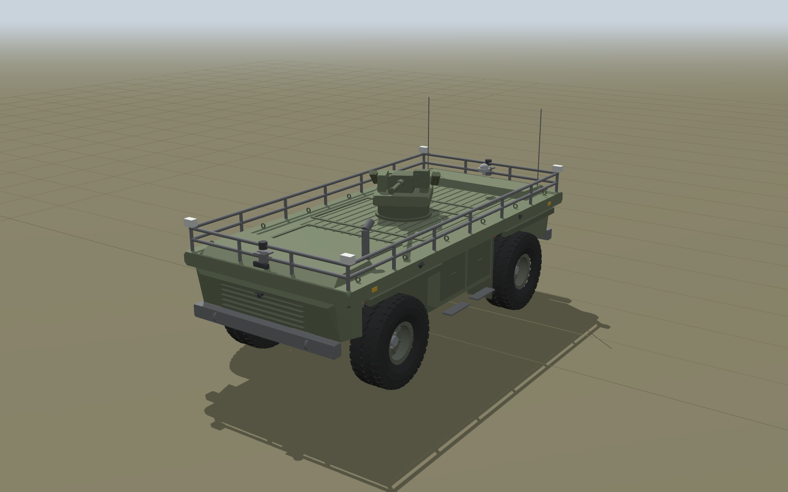
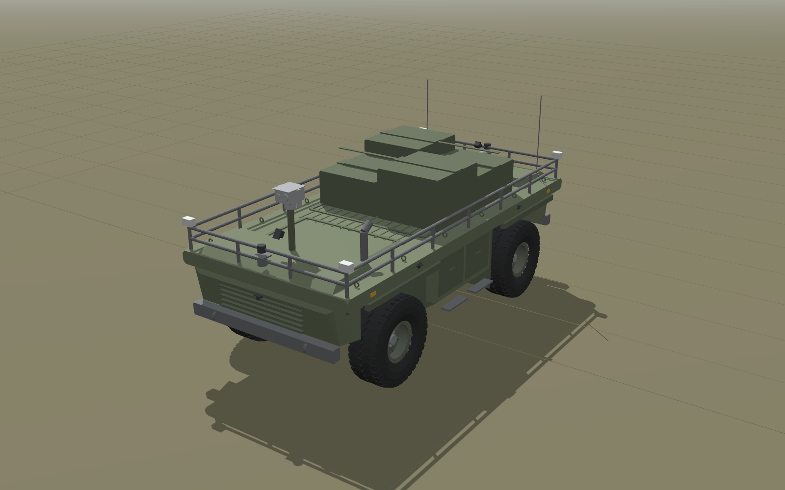
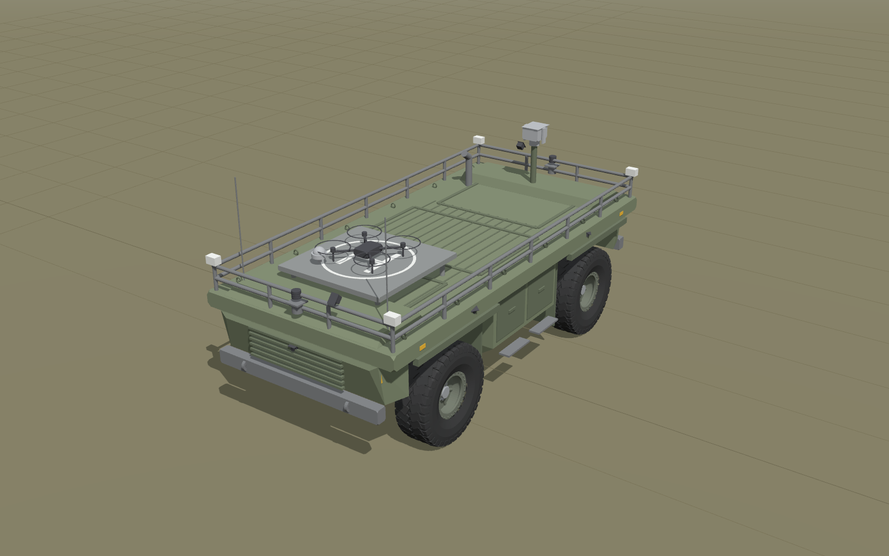

# HUNTeR URDF: Łukasiewicz-PIAP HUNTeR UGV replica for ROS 2

A simulation-ready replica of the **Łukasiewicz-PIAP HUNTeR**, the 3.5 to 4 t hybrid 4x4 unmanned ground vehicle from the Łukasiewicz Research Network, Industrial Research Institute for Automation and Measurements (Warsaw). It has two steering axles, rigid axles on a 3-link + Panhard rod coil-over suspension, the published sensor suite, and the mission payloads seen since 2020. It targets **ROS 2 Jazzy + Gazebo Harmonic** with `ros2_control`.

No CAD of the real vehicle is public. Everything here was rebuilt from PIAP's own published specifications (INTARG 2021 poster, 2017/2018 PIAP procurement notices) and press coverage, then completed by engineering calculation. Every number is traceable: see [`docs/DESIGN_REPORT.md`](docs/DESIGN_REPORT.md).


| Running gear (hull hidden) | Counter-phase 4WS at full lock | Axle articulation |
|---|---|---|
|  |  |  |

| 2023+ armed variant, ZMU-03 RWS | Cargo mule | UAV landing pad |
|---|---|---|
|  |  |  |

## How faithful is it?

| Aspect | Status | Value in the model |
|---|---|---|
| Length x width, wheelbase | published (PIAP poster) | 4.70 x 2.20 m, 2.70 m |
| Wheels | published | 1.00 m diameter; 40x13.50R17-class tyre on 17x9 beadlocks (estimated from the 8x6.5 in bolt pattern) |
| Kerb mass | published | 3500 kg (2020 prototype); 4050 kg armed (press: "over 4 t") |
| Axles | published (PIAP tender ZO/11/07/2017) | Ultimate Dana 60 front steer axles at both ends: ratio 5.38, 70 in wheel-mount width => track 1.803 m, 358 mm discs |
| Suspension | published type and stroke | dependent 3-link + Panhard rod, coil springs, controlled dampers, 250 mm stroke |
| Steering | published: two steering axles | 4WS, 35 deg lock (estimated), steering trapezoid optimised for counter-phase |
| Drive | published | 2 PMSM traction motors (one per axle), 90 kW continuous / 220 kW peak, 110 kW generator, 40 kWh NMC |
| Top speed, payload | published | 50 km/h, 1000 kg |
| Sensors | published layout | 2 x 3D lidar, front/rear driving cameras, 2 side cameras per side, 2 top-view cameras on the railing, PTZ (2020); stereo camera (2024); GNSS, IMU |
| Spring/damper rates, mass distribution, inertias | **derived/design** | sized for the published stroke and masses: 62.7 kN/m, 1.5 Hz ride, zeta 0.35 |
| Hull shape, sensor positions | **reconstructed** | no drawings or usable photos were available to this build; see "Improving fidelity" |

## Packages

| Package | Contents |
|---|---|
| [`hunter_description`](hunter_description) | xacro model, generated parameter file `config/vehicle.yaml`, meshes, RViz config, `display.launch.py`, URDF tests |
| [`hunter_control`](hunter_control) | `four_ws_controller` (4WS drive controller + wheel odometry), `suspension_linkage_publisher` (draws links, Panhard rods, coil-overs, tie rods), ros2_control controller config, kinematics tests |
| [`hunter_gazebo`](hunter_gazebo) | worlds (`flat.sdf`, `offroad.sdf` test course), bridge config, `sim.launch.py` |
| [`tools`](tools) | `vehicle_design.py` (engineering model, single source of truth), `generate_meshes.py`, `render/` (doc images), `sim_tests/drive_test.py` (closed-loop Gazebo validation) |

## Quick start

Requirements: ROS 2 Jazzy, Gazebo Harmonic, `ros_gz`, `gz_ros2_control`, `ros2_controllers`, `xacro`, `robot_state_publisher`, `joint_state_publisher_gui`, `rviz2`.

```bash
mkdir -p ~/hunter_ws/src && cd ~/hunter_ws/src
git clone <this repository> hunter_urdf
cd ~/hunter_ws && rosdep install --from-paths src -iy
colcon build && source install/setup.bash

# Inspect the model with joint sliders (suspension, steering, PTZ, RWS)
ros2 launch hunter_description display.launch.py
ros2 launch hunter_description display.launch.py variant:=2023 payload:=rws

# Simulate
ros2 launch hunter_gazebo sim.launch.py
ros2 launch hunter_gazebo sim.launch.py world:=offroad.sdf variant:=2023 payload:=rws

# Drive (cmd_vel is geometry_msgs/Twist; use_stamped_vel:=true for TwistStamped, e.g. Nav2)
ros2 run teleop_twist_keyboard teleop_twist_keyboard
ros2 topic pub --once /four_ws_controller/steering_mode std_msgs/String "data: crab"
```

Cameras are rendered by Gazebo; on a machine without a GPU, start with `camera_sensors:=false` (or `sensors:=false`) to keep the simulation real time.

### xacro / launch arguments

| Argument | Values | Effect |
|---|---|---|
| `variant` | `2020` (default), `2023` | 2020 prototype (3.5 t, PTZ mast, top-view cameras) or the armed-era vehicle (4.05 t, stereo camera) |
| `payload` | `none`, `cargo`, `rws`, `uav_pad` | deck module; `cargo_mass` sets the cargo mass (default 600 kg, max 1000 kg) |
| `sensors`, `camera_sensors` | `true`/`false` | all sensors / only the Gazebo camera sensors |
| `lidar_resolution` | 0..1 | fraction of the lidars' native 1024 horizontal samples simulated |
| `visual_detail` | `mesh`, `primitive` | detailed meshes or boxes/cylinders |
| `sim_mode` (xacro) | `none`, `gz`, `mock`, `hardware` | ros2_control backend |
| `steering_mode` (sim) | `front`, `rear`, `counter`, `crab`, `adaptive`, `free` | initial 4WS mode |
| `linkage` (sim) | `trapezoid` (default), `ideal` | mechanical tie-rod linkage or exact Ackermann per wheel |

### Steering modes

The real vehicle has one electric steering actuator per axle; each Dana 60 couples its knuckles through a tie rod. The controller therefore sends linkage-consistent left/right angles (four-bar solution) unless `linkage:=ideal`.

| Mode | Behaviour | Min. turning radius (outer tyre) |
|---|---|---|
| `counter` (default) | front and rear axles steer in opposite directions, instantaneous centre on the mid-wheelbase line | 3.92 m |
| `front` / `rear` | conventional 2WS on one axle | 7.00 m |
| `crab` | both axles steer in phase; the hull translates diagonally without yawing | n/a |
| `adaptive` | counter-phase below 2 m/s, blending to front-only above 8 m/s | |
| `free` | any planar twist `(vx, vy, wz)` the steering limits allow | |

Also available: `differential:=locked` (emulates the axle differential locks), acceleration, yaw-rate and lateral-acceleration limits, `ackermann_cmd` input (AckermannDriveStamped), least-squares wheel odometry on `/odom` + TF.

### Topics (simulation)

| Topic | Type |
|---|---|
| `/cmd_vel`, `/ackermann_cmd` | Twist (or TwistStamped), AckermannDriveStamped |
| `/four_ws_controller/steering_mode` | std_msgs/String |
| `/odom`, `/ground_truth/odom` | nav_msgs/Odometry |
| `/joint_states` | sensor_msgs/JointState (wheels, knuckles, axle heave/roll, PTZ, RWS) |
| `/front_lidar/points`, `/rear_lidar/points` | sensor_msgs/PointCloud2 |
| `/<camera>/image_raw`, `/<camera>/camera_info` | front/rear_drive, left/right_front/rear, top_front/rear, ptz, front_stereo_left/right, rws |
| `/imu/data`, `/gnss/fix` | sensor_msgs/Imu, sensor_msgs/NavSatFix |
| `/ptz_controller/commands`, `/rws_controller/commands` | std_msgs/Float64MultiArray [pan, tilt] / [yaw, pitch] |
| `/suspension_linkage/markers`, `/suspension_linkage/coilover_lengths` | RViz linkage, coil-over lengths |

## Suspension and steering model

URDF cannot hold the closed 3-link + Panhard loops, so each rigid axle is the equivalent open chain `base_link` (prismatic z, heave) then (revolute x, roll about the Panhard rod axis). The two coil-overs become a heave spring `2 k_w` and a roll spring `2 k_w (s/2)^2 + k_arb`, plus matching dampers, written as SDF `spring_stiffness` / `spring_reference` / `damping`. The spring references put the joints at zero at the kerb weight, so payload sags the suspension physically. Joint limits are the published 250 mm stroke (146 mm bump / 104 mm droop) and the resulting +/-7.9 deg articulation. The physical links are drawn live in RViz from the joint states.

Details, simplifications and their error bounds are in [`docs/MODEL.md`](docs/MODEL.md).

## Validation

`colcon test` runs the URDF checks (7 configurations: parse, total mass against the published kerb mass, inertia validity, meshes, joint limits, design file up to date) and 25 kinematics tests. Closed-loop Gazebo results ([`docs/VALIDATION.md`](docs/VALIDATION.md)):

| Test | Expected | Gazebo |
|---|---|---|
| Static suspension position at kerb mass | 0 mm | +2 mm |
| Sag, armed variant (+550 kg) | 22 mm | 24 mm |
| Wheel odometry over 80 m at 8 m/s | | 0.3 % error |
| 4WS circle, 2 m/s, R 8.0 m | 8.000 m | 8.007 m |
| 2WS circle, 2 m/s, R 13.4 m | 13.402 m | 13.467 m |
| Full-lock radius 4WS / 2WS (vehicle centre) | 2.77 / 5.71 m | 2.74 / 5.57 m |
| Crab: heading change over 10 s | 0 deg | 0.2 deg |
| Articulation twister (0.30 m humps) | +/-7.9 deg limit | 7.9 deg reached, passed |
| 30 % grade at 2 m/s, 0.30 m step | climbs | passed |

## Regenerating

```bash
python3 tools/vehicle_design.py        # parameters + design report (edit this file, never vehicle.yaml)
python3 tools/generate_meshes.py       # meshes from the parameters
python3 tools/render/render_docs.py    # docs/images (needs node: see tools/render/render.mjs)
```

## Improving fidelity

The weakest parts are the hull shape and sensor positions. They follow the published layout and constraints (overall size, wheel clearances at full lock and bump, approach angle), but no photos could be measured during this build. With press photos, the 1 m wheel gives a scale reference to measure deck height, overhang shape and sensor positions; edit the geometry section of `tools/vehicle_design.py` and the hull functions of `tools/generate_meshes.py`. If PIAP CAD becomes available, drop the meshes into `hunter_description/meshes/visual/` with the same frames.

## Sources

PIAP INTARG 2021 poster; PIAP procurement notices ZO/11/07/2017 (drive axles) and ZWR/01/2018 (traction motors); Janes (2020); Milmag (2020, 2025, 2026); Defence24 (2021 to 2026); Army Recognition (2024); Zbiam (2023); Polska Zbrojna (2026); WB Group ZMU-05 flyer; Spicer/Dana Ultimate 60 data. Full list with what each one states: [`docs/DESIGN_REPORT.md`](docs/DESIGN_REPORT.md#sources). Raw search results are archived in [`docs/research/raw_findings.json`](docs/research/raw_findings.json).

This is an independent research model, not an official PIAP product.

## License

Apache-2.0
