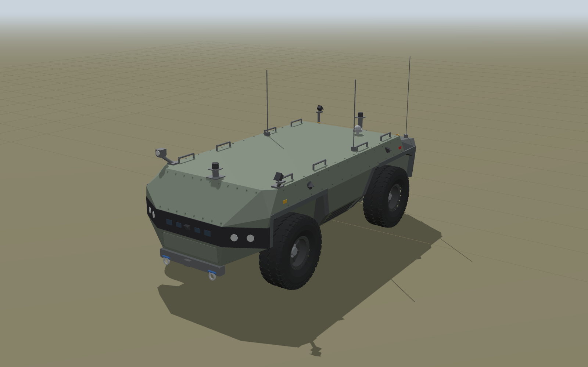
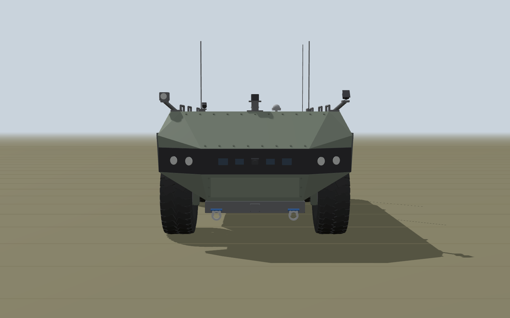
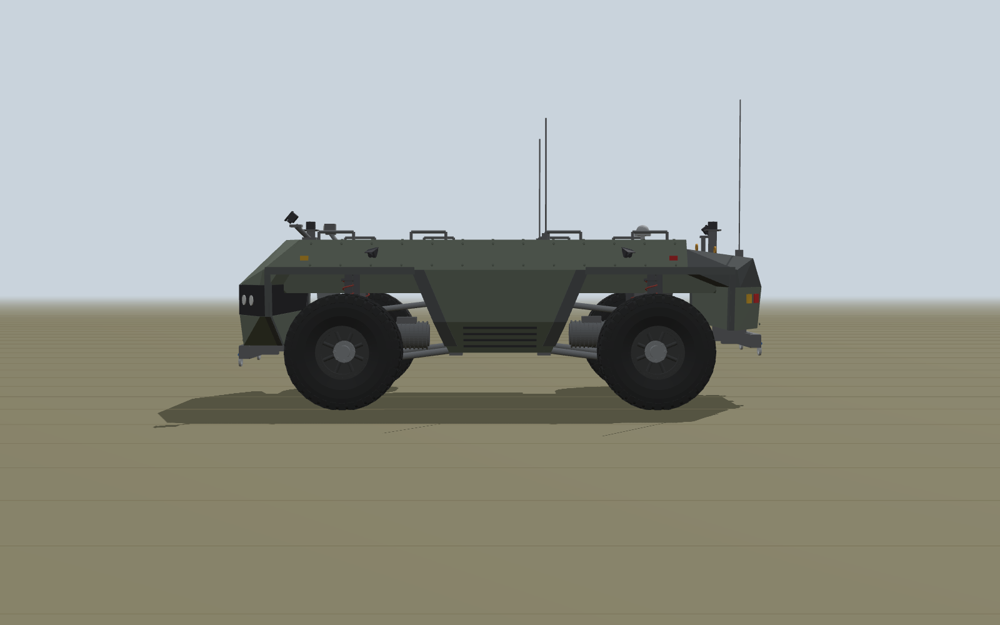
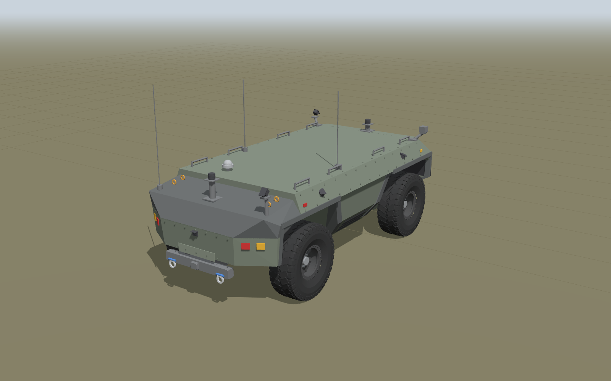
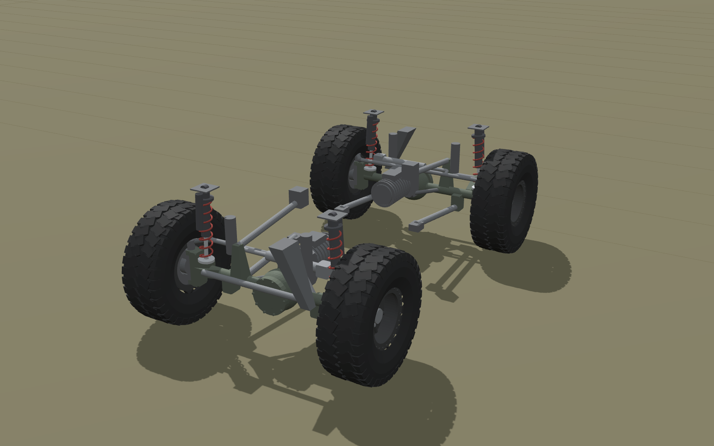
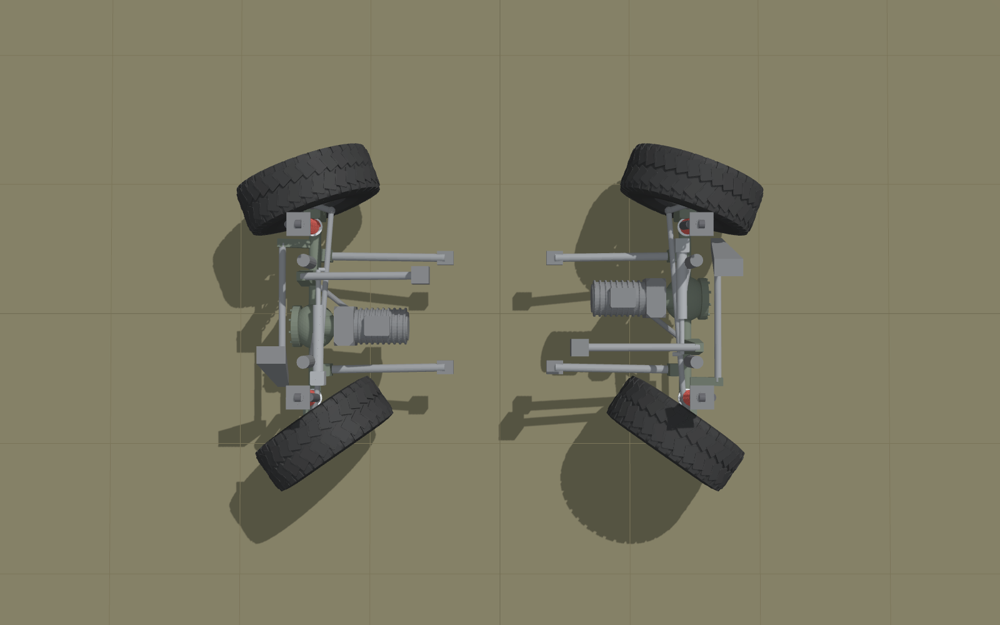
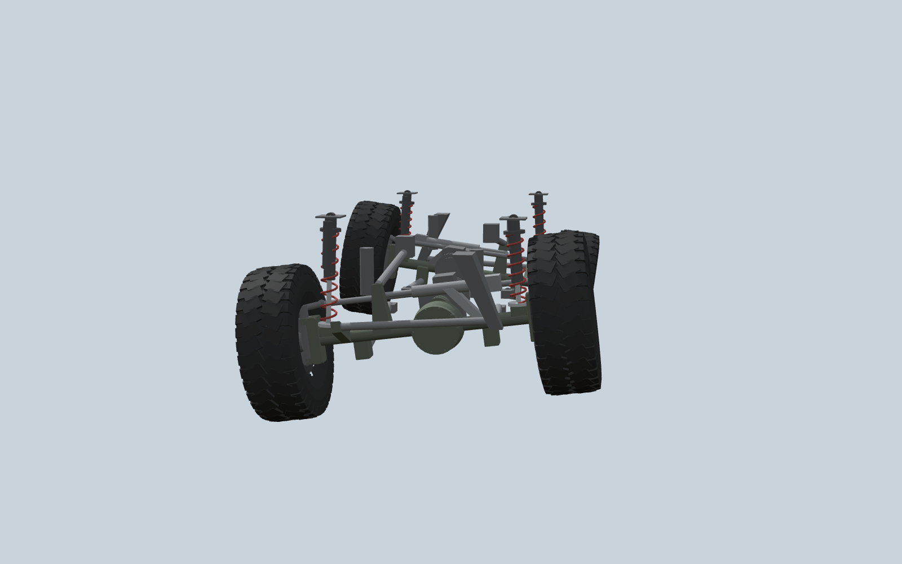

# HUNTeR URDF: Łukasiewicz-PIAP HUNTeR UGV replica for ROS 2

A simulation-ready replica of the **Łukasiewicz-PIAP HUNTeR**, the 3.5 t hybrid 4x4 unmanned ground vehicle from the Łukasiewicz Research Network, Industrial Research Institute for Automation and Measurements (Warsaw). The running gear is the bare platform as published from 2020 on: two steering axles, rigid axles on a 3-link + Panhard rod suspension with coil springs and controlled dampers, and the published sensor layout. The hull follows the closed, faceted body of the vehicle as photographed in 2023-2025: a flat deck, a sloped glacis above a full-width black sensor band with four LED lamps, a narrow chin with a tow bar and two shackles, angular wheel arches with dark trims, inward-leaning side panels and a dark, stepped-down rear deck. It targets **ROS 2 Jazzy + Gazebo Harmonic** with `ros2_control`.

No CAD of the real vehicle is public. Everything here was rebuilt from PIAP's published specifications (the INTARG 2021 poster as quoted in search results, 2017/2018 PIAP procurement notices), press coverage and press photos measured against the 1 m wheel, then completed by engineering calculation. Every number is traceable: see [`docs/DESIGN_REPORT.md`](docs/DESIGN_REPORT.md).



| Front | Side | Rear |
|---|---|---|
|  |  |  |

| Running gear (hull hidden) | Counter-phase 4WS at full lock | Axle articulation |
|---|---|---|
|  |  |  |

## How faithful is it?

| Aspect | Status | Value in the model |
|---|---|---|
| Length x width, wheelbase | published | 4.70 x 2.20 m; 2.70 m (PIAP poster via search summaries, Army Recognition, Militär Aktuell; some Polish press prints 2.20 m, likely copied from the width) |
| Wheels | published | 1.00 m diameter; 40x13.50R17-class tyre on 17x9 beadlocks (estimated from the 8x6.5 in bolt pattern) |
| Kerb mass | published | 3500 kg (2020 prototype; later configurations are quoted at "over 4 t", not modelled) |
| Axles | published request + assumptions | PIAP tender ZO/11/07/2017 asked for 3 rigid front drive axles, "Ultimate Dana 60 or equivalent": ratio 5.38, 70 in wheel-mount width, 8x6.5 in bolts, discs >= 350 mm. Assumed: such axles fitted at both ends; track 1.803 m (derived with an estimated wheel offset); 358 mm discs (generic crate axle) |
| Suspension | published type and stroke | dependent 3-link + Panhard rod, coil springs, controlled dampers, 250 mm stroke |
| Steering | published: two steering axles | 4WS; 35 deg lock, one actuator and tie rod per axle, trapezoid optimised for counter-phase (all estimated / design) |
| Drive | published | 2 PMSM traction motors (one per axle), 90 kW continuous / 220 kW peak, 110 kW generator, 40 kWh NMC |
| Top speed, payload | published | 50 km/h, 1000 kg |
| Sensors | published layout, assumed details | published: GPS, 2 lidars, front/rear driving cameras, 2 side cameras per side, top-view cameras (on the 2020 railing), PTZ. Modelled: those except the PTZ (see "Not modelled"), with 2 top-view cameras (count not published) and an IMU (assumed), mounted on the photographed hull: driving camera in the front sensor band, side cameras in the upper flanks, top-view cameras on the deck-corner outriggers |
| Spring/damper rates, mass distribution, inertias | **derived/design** | sized for the published stroke and masses: 70.5 / 55.2 kN/m front/rear, 1.5 Hz ride at both ends, zeta 0.35 |
| Hull shape | **photo-measured** | 2023-2025 press photos scaled by the 1 m wheel: deck 1.46 m, arch tops 1.20 m, sensor band 0.80-1.07 m, front / rear tow bar lower edge 0.40 / 0.50 m (+/-5 to 10 %). Approach / departure 25 / 30 deg (derived) |
| Sensor positions | **reconstructed** | mounting points visible in the photos are used where they exist; exact positions are not published |

## Packages

| Package | Contents |
|---|---|
| [`hunter_description`](hunter_description) | xacro model, generated parameter file `config/vehicle.yaml`, meshes, RViz config, `display.launch.py`, URDF tests |
| [`hunter_control`](hunter_control) | `four_ws_controller` (4WS drive controller + wheel odometry), `suspension_linkage_publisher` (draws links, Panhard rods, coil-overs, tie rods), ros2_control controller config, kinematics tests |
| [`hunter_gazebo`](hunter_gazebo) | worlds (`flat.sdf`, `offroad.sdf` test course), bridge config, `sim.launch.py` |
| [`tools`](tools) | `vehicle_design.py` (engineering model, single source of truth), `generate_meshes.py`, `render/` (doc images), `sim_tests/drive_test.py` (closed-loop Gazebo validation) |

## Quick start

Requirements: ROS 2 Jazzy, Gazebo Harmonic, `ros_gz`, `gz_ros2_control`, `ros2_controllers`, `xacro`, `robot_state_publisher`, `joint_state_publisher_gui`, `rviz2`.

```bash
mkdir -p ~/hunter_ws/src && cd ~/hunter_ws/src
git clone <this repository> hunter_urdf
cd ~/hunter_ws && rosdep install --from-paths src -iy
colcon build && source install/setup.bash

# Inspect the model with joint sliders (suspension, steering)
ros2 launch hunter_description display.launch.py

# Simulate
ros2 launch hunter_gazebo sim.launch.py
ros2 launch hunter_gazebo sim.launch.py world:=offroad.sdf

# Drive (cmd_vel is geometry_msgs/Twist; use_stamped_vel:=true for TwistStamped, e.g. Nav2)
ros2 run teleop_twist_keyboard teleop_twist_keyboard
ros2 topic pub --once /four_ws_controller/steering_mode std_msgs/String "data: crab"
```

Cameras are rendered by Gazebo; on a machine without a GPU, start with `camera_sensors:=false` (or `sensors:=false`) to keep the simulation real time.

### xacro / launch arguments

| Argument | Values | Effect |
|---|---|---|
| `sensors`, `camera_sensors` | `true`/`false` | all sensors / only the Gazebo camera sensors |
| `lidar_resolution` | 0..1 | fraction of the lidars' native 1024 horizontal samples simulated |
| `visual_detail` | `mesh`, `primitive` | detailed meshes or boxes/cylinders |
| `sim_mode` (xacro) | `none`, `gz`, `mock`, `hardware` | ros2_control backend |
| `steering_mode` (sim) | `front`, `rear`, `counter`, `crab`, `adaptive`, `free` | initial 4WS mode |
| `linkage` (sim) | `trapezoid` (default), `ideal` | mechanical tie-rod linkage or exact Ackermann per wheel |

### Steering modes

The replica assumes one steering actuator per axle driving a tie rod between the knuckles, as on a Dana 60 steer axle (the actuator type is not published). The controller therefore sends linkage-consistent left/right angles (four-bar solution) unless `linkage:=ideal`.

| Mode | Behaviour | Min. turning radius (outer tyre) |
|---|---|---|
| `counter` (default) | front and rear axles steer in opposite directions, instantaneous centre on the mid-wheelbase line | 3.92 m |
| `front` / `rear` | conventional 2WS on one axle | 7.00 m |
| `crab` | both axles steer in phase; the hull translates diagonally without yawing | n/a |
| `adaptive` | counter-phase below 2 m/s, blending to front-only above 8 m/s | |
| `free` | any planar twist `(vx, vy, wz)` the steering limits allow | |

Also available: `differential:=locked` (emulates the axle differential locks), acceleration, yaw-rate and lateral-acceleration limits that keep the commanded path curvature, `ackermann_cmd` input (AckermannDriveStamped; positive angle = left turn in every mode), least-squares wheel odometry on `/odom` and TF `odom -> base_footprint`.

### Topics (simulation)

| Topic | Type |
|---|---|
| `/cmd_vel`, `/ackermann_cmd` | Twist (or TwistStamped), AckermannDriveStamped |
| `/four_ws_controller/steering_mode` | std_msgs/String |
| `/odom`, `/ground_truth/odom` | nav_msgs/Odometry (`odom -> base_footprint`) |
| `/joint_states` | sensor_msgs/JointState (wheels, knuckles, axle heave/roll) |
| `/front_lidar/points`, `/rear_lidar/points` | sensor_msgs/PointCloud2 |
| `/<camera>/image_raw`, `/<camera>/camera_info` | front/rear_drive, left/right_front/rear, top_front/rear |
| `/imu/data`, `/gnss/fix` | sensor_msgs/Imu, sensor_msgs/NavSatFix |
| `/suspension_linkage/markers`, `/suspension_linkage/coilover_lengths` | RViz linkage, coil-over lengths |

## Suspension and steering model

URDF cannot hold the closed 3-link + Panhard loops, so each rigid axle is the equivalent open chain `base_link` (prismatic z, heave) then (revolute x, roll about the Panhard rod axis). The coil springs are sized per axle for a 1.5 Hz ride at both ends (70.5 / 55.2 kN/m per corner front/rear, dampers at zeta 0.35). Because the simulated tyre is rigid, the joint springs carry the coil springs in series with the tyres (SDF `spring_stiffness` / `spring_reference` / `damping`), so the body keeps the design ride frequency and static drop; the references put the joints at zero at kerb weight, so payload sags the suspension physically. Joint limits are the published 250 mm stroke (front 158 mm bump / 92 mm droop, rear 155 / 95 mm) and the resulting +/-7.9 deg articulation. The physical links, Panhard rods, coil-overs and high-steer tie rods are drawn live in RViz from the joint states.

Details, simplifications and their error bounds are in [`docs/MODEL.md`](docs/MODEL.md).

## Validation

`colcon test` runs the URDF checks (5 configurations: parse, total mass against the kerb mass, inertia validity, meshes, joint limits, published envelope and heights, hull clearance against the running gear, design file up to date), the 4WS kinematics and odometry tests and the command-shaping tests (88 tests). The model and code were also put through a six-lens adversarial review (geometry, controller, physics, source fidelity, ROS integration, linkage/meshes); its confirmed findings are fixed. Closed-loop Gazebo results ([`docs/VALIDATION.md`](docs/VALIDATION.md)) were recorded before the hull was reshaped to the photographed vehicle. Mass, inertia, suspension, steering and drivetrain did not change, so they still describe the dynamics; hull-terrain contact on the off-road course was not re-run (the lowest overhang point is now the 0.40 m tow bar, approach angle 25 deg, still above the course's 30 % grade):

| Test | Expected | Gazebo |
|---|---|---|
| Static suspension position at kerb mass | 0 mm | +2.7 / +2.3 mm |
| Wheel odometry over 80 m at 8 m/s | | 0.3 % error |
| 4WS circle, 2 m/s, R 8.0 m | 8.000 m | 8.012 m |
| 2WS circle, 2 m/s, R 13.4 m | 13.402 m | 13.456 m |
| Full-lock radius 4WS / 2WS (vehicle centre) | 2.77 / 5.71 m | 2.74 / 5.59 m |
| Reverse 4WS / rear-steer circles | 7.50 / 13.40 m | 7.54 / 13.40 m |
| Crab: track angle, heading change over 10 s | 21.8 deg, 0 deg | 22.7 deg, 0.7 deg |
| Articulation twister (0.30 m humps) | +/-7.9 deg limit | 7.9 deg reached, passed |
| 30 % grade at 2 m/s, 0.30 m step | climbs | passed |

## Regenerating

```bash
python3 tools/vehicle_design.py        # parameters + design report (edit this file, never vehicle.yaml)
python3 tools/generate_meshes.py       # meshes from the parameters
python3 tools/check_clearance.py       # hull vs tyres/axles over the steering and suspension envelope
python3 tools/render/render_docs.py    # docs/images (needs node: see tools/render/render.mjs)
```

## Not modelled

Mission equipment is not part of this model, which covers the bare platform only: the AREX ZMU-03 / ZMU-05 remote weapon stations, the deck cargo box seen at OPEX 2025, and the hydraulic manipulator and ground-penetrating radar mentioned in 2020. The 2020 PTZ camera mast is not modelled either: on the photographed vehicles that role is taken by the weapon station's or payload's own sensor head.

## Improving fidelity

The hull was measured off five press photos of the 2023-2025 vehicle (listed under `PHOTOS` in `docs/DESIGN_REPORT.md`), so its heights carry roughly +/-5 to 10 % uncertainty; plan-view details that no photo shows squarely (the exact chamfer angles of the nose and tail, the tub end slope, the underbody) are design choices that respect the running-gear clearances, which `tools/check_clearance.py` verifies over the full steering and suspension envelope. The weakest parts are now the sensor positions and the mass budget, which is still the 2020 open-deck estimate (a closed hull would move the CG up by about 2 cm). To refine the hull, edit the geometry section of `tools/vehicle_design.py` and the hull functions of `tools/generate_meshes.py`, then re-run both and the clearance check. If PIAP CAD becomes available, drop the meshes into `hunter_description/meshes/visual/` with the same frames.

## Sources

PIAP INTARG 2021 poster; PIAP procurement notices ZO/11/07/2017 (drive axles) and ZWR/01/2018 (traction motors); Janes (2020); Milmag (2020, 2024, 2025); Defence24 (2023); Army Recognition (2024); Zbiam (2023); Polska Zbrojna (2026); Spicer/Dana Ultimate 60 data; press photos from FEX-23/24 (Nowa Dęba), Eurosatory 2024, OPEX 2025 and the 2025 Italian Army trials. Full list with what each one states: [`docs/DESIGN_REPORT.md`](docs/DESIGN_REPORT.md#sources). Raw search results are archived in [`docs/research/raw_findings.json`](docs/research/raw_findings.json).

This is an independent research model, not an official PIAP product.

## License

Apache-2.0
