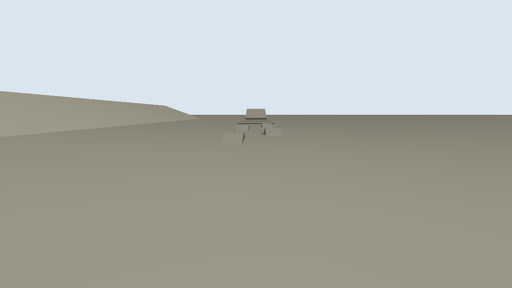
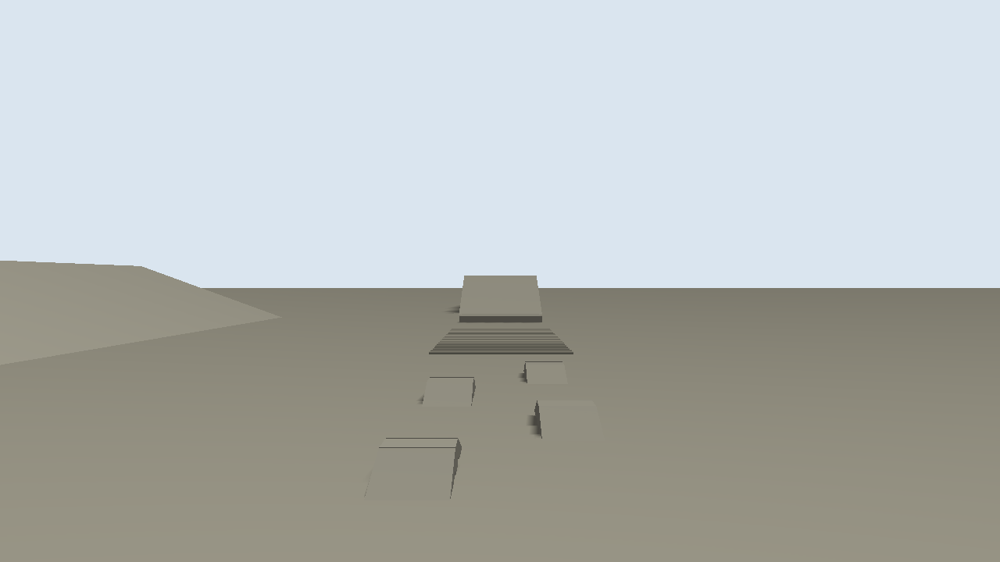

# Validation

Closed-loop results from Gazebo Harmonic (DART, 1 ms step) with the default model (`variant:=2020`, trapezoid steering linkage), produced by `tools/sim_tests/drive_test.py` and written by `tools/sim_tests/write_report.py`. Raw reports are in [`validation/`](validation/). Expected values come from the kinematics module and `vehicle.yaml`, so these tests check that the simulated vehicle behaves like its own design.

## Flat ground (`flat.sdf`)

| Test | Expected | Measured |
|---|---|---|
| Front / rear axle heave at kerb mass | 0 / 0 mm | +2.7 / +2.3 mm |
| Front / rear axle roll at rest | 0 deg | +0.002 / -0.002 deg |
| Straight line at 8 m/s: speed | 8.00 m/s | 7.972 m/s |
| Straight line: wheel odometry vs ground truth over 79.7 m | 0 % | +0.32 % |
| Straight line: lateral drift over 79.7 m (open loop) | 0 m | 0.83 m |
| 4WS counter-phase circle, 2 m/s: radius | 8.000 m | 8.012 m (+0.15 %) |
| 4WS counter-phase circle, 2 m/s: yaw rate | 0.2500 rad/s | 0.2486 rad/s |
| 2WS front-steer circle, 2 m/s: radius | 13.402 m | 13.456 m (+0.41 %) |
| 2WS front-steer circle, 2 m/s: yaw rate | 0.1500 rad/s | 0.1490 rad/s |
| 4WS full lock (vehicle centre path): radius | 2.774 m | 2.738 m (-1.29 %) |
| 4WS full lock (vehicle centre path): yaw rate | 0.5407 rad/s | 0.5329 rad/s |
| 2WS full lock (vehicle centre path): radius | 5.710 m | 5.593 m (-2.05 %) |
| 2WS full lock (vehicle centre path): yaw rate | 0.2703 rad/s | 0.2725 rad/s |
| 4WS circle in reverse, 1.5 m/s: radius | 7.500 m | 7.537 m (+0.50 %) |
| 2WS rear-steer circle, 2 m/s: radius | 13.402 m | 13.401 m (-0.01 %) |
| Adaptive mode at 10 m/s: radius | 100.009 m | 97.860 m (-2.15 %) |
| Ackermann input (2 m/s, 0.2 rad, counter mode): radius | 6.660 m | 6.697 m |
| Crab 1.5 + 0.6 m/s: track angle | 21.8 deg | 22.7 deg |
| Crab: heading change over 10 s | 0 deg | -0.73 deg |
| Command timeout: speed 6 s after the last command | 0 m/s | 0.000 m/s |

Design turning radius at the outer tyre: 3.92 m (4WS), 7.00 m (2WS).

Notes: the full-lock circles come out 1 to 2 % tighter than kinematics because the rigid tyres scrub. The crab track-angle offset comes from the mechanical trapezoid, which cannot hold both wheels of an axle parallel (`linkage:=ideal` gives exactly parallel wheels). The straight-line drift is an open-loop figure: the 4WS controller has no heading feedback, so a path follower or Nav2 controller removes it. The static heave settles about 2.5 mm into bump in every configuration (2 % of the static sag); masses and spring references in the generated SDF match the design exactly, so this is the equilibrium of DART's contact and joint-servo constraints.

## Off-road course (`offroad.sdf`, 2 m/s, counter-phase mode)

| Section | Result |
|---|---|
| Articulation twister, 0.30 m humps alternating left/right | passed; axle roll 7.94 / 7.95 deg (limit 7.94), front heave -42 .. 36 mm, body roll 7.4 deg |
| 0.30 m step | passed; max pitch 7.9 deg |
| 30 % grade (16.7 deg) | climbed at 2.00 m/s; body pitch 17.9 deg (slope 16.7 deg + suspension squat) |
| Course completed | True (final x 66.0 m) |

The 0.30 m humps exceed the 250 mm stroke, so the axles reach the articulation limit and the body takes the rest as roll, the expected behaviour of the published suspension.

## Configurations

| Check | Expected | Measured |
|---|---|---|
| Armed configuration (`variant:=2023 payload:=rws`, +550 kg): front / rear sag | 23.2 / 28.0 mm | 26.3 / 30.9 mm |
| RWS position controller: yaw / pitch | 1.0 / 0.3 rad | 1.0 / 0.3 rad |
| Sensors (rendered under Xvfb, CPU): lidar clouds 16384 points, 1280x720 images, NavSat, IMU | published | published, frame ids = optical / sensor frames |

Sensor images from the simulation (front driving camera and PTZ looking at the off-road course):

## Static tests (`colcon test`)

* `hunter_description/test/test_urdf.py`: 7 configurations; `check_urdf`; total mass within 1 % of the kerb mass (3500 kg published; 4050 kg estimated for the armed configuration; + payload); every inertia positive definite and satisfying the triangle inequality; every mesh present; ros2_control joints exist; heave travel equals the published 250 mm stroke on both axles; published envelope (4.70 x 2.20 m, 2.70 m wheelbase, 1 m wheels); design outputs up to date.
* `hunter_control/test/test_kinematics.py`: 4WS kinematics (straight line, reverse, counter-phase symmetry, Ackermann normals meeting at the instantaneous centre, crab, forward/inverse round trip in every mode for the ideal linkage and in every ICR mode for both linkages and both differential settings, steering limits, trapezoid symmetry and Ackermann error, locked differential, turning radius).
* `hunter_control/test/test_command_shaper.py`: curvature held while accelerating, acceleration/deceleration limits, no steering windup, ramped slowdown on steering lag, linkage-consistent steering slew, yaw-rate and lateral-acceleration limits, rotate-in-place pre-steer, reverse arcs, free-mode anti-windup.
